# marIAn : sources et parcours agentiques

Oct 8, 2026 · @Emilie

## Objectif et public

marIAn (nom de travail) est une plateforme faite par des jeunes, pour des jeunes : elle met côte à côte, thème par thème, ce que chaque candidat à la présidentielle 2027 promet et ce qu'il a fait depuis 2022. Chaque élément affiché renvoie à une source vérifiable.

**Pour qui.** Les 16-25 ans : primo-votants à une présidentielle en 2027 (nés entre 2004 et 2009), lycéens de 16-17 ans qui voteront plus tard, étudiants, jeunes actifs. Usage surtout sur téléphone, sessions courtes, peu de temps pour lire des programmes de 100 pages.

**Ce que la plateforme fait.**

- Classe les promesses par thème, avec la citation exacte et le lien.
- Met en face les actes du candidat sur 5 ans (votes, propositions de loi, amendements, taux de présence) à l'Assemblée, au Sénat ou au Parlement européen. Sans mandat, on l'indique ; les votes de sa formation peuvent servir de contexte, signalés comme tels.
- Explique les mots compliqués (49.3, motion de censure, PLFSS…).
- Affiche un indice d'alignement entre promesse et actes : conforme, déviant (plus souple ou plus rigide), pas de mandat. Compare chaque promesse à celle de 2022 quand elle existe.

**Ce qu'elle ne fait pas.**

- Elle ne donne pas de consigne de vote. L'indice compare un candidat à ses propres promesses, jamais les candidats entre eux.
- Elle ne publie rien sans source.
- Elle ne déduit pas le vote d'un candidat du vote de son groupe sans le dire.

## Contexte au 8 octobre 2026

La liste des candidats n'est pas stabilisée : franceinfo compte 32 déclarés au 7 octobre, Repère 2027 en compte 23. La liste officielle ne sera publiée par le Conseil constitutionnel qu'après la collecte des 500 parrainages, au printemps 2027.

| Candidat | Formation | Statut au 8 oct. 2026 | Groupe à rapprocher pour les votes |
| --- | --- | --- | --- |
| Gabriel Attal | Renaissance | Déclaré | Ensemble pour la République (EPR) |
| Olivier Faure | Parti socialiste | Primaire de la gauche | Socialistes |
| Raphaël Glucksmann | Place publique | Primaire de la gauche | Socialistes |
| Marine Le Pen | Rassemblement national | Déclarée, voir ci-dessous | Rassemblement national |
| Jean-Luc Mélenchon | La France insoumise | Déclaré | La France insoumise |
| Édouard Philippe | Horizons | Déclaré | Horizons |
| Bruno Retailleau | Les Républicains | Déclaré | Droite républicaine (LR) |
| Fabien Roussel | PCF | Déclaré le 6 sept. 2026 | Gauche démocrate et républicaine (GDR) |
| Marine Tondelier | Les Écologistes | Candidature autonome validée en principe | Écologistes |

Autres noms cités comme déclarés : Nathalie Arthaud, Delphine Batho, Xavier Bertrand, Karim Bouamrane, Bernard Cazeneuve, Nicolas Dupont-Aignan, Anasse Kazib, David Lisnard, Florian Philippot, Olivier Becht. Pressentis : Bruno Le Maire (décision annoncée pour octobre 2026), Dominique de Villepin.

**Points à surveiller**

- **Primaire de la gauche :** dates contradictoires selon les sources (9-10 et 16-17 octobre, ou 10 octobre). À vérifier auprès du PS. Le vainqueur remplacera plusieurs lignes du tableau.
- **Marine Le Pen :** la cour d'appel de Paris a ramené son inéligibilité à 45 mois dont 30 avec sursis le 7 juillet 2026, ce qui lui permet en théorie de se présenter. Un éventuel pourvoi en cassation n'a pas été vérifié. Jordan Bardella reste le plan de repli cité avant la décision.
- **Bruno Le Maire :** décision attendue en octobre.
- **Dates du scrutin :** avril-mai 2027, dates exactes fixées par décret, à confirmer.

Le groupe rapproché est celui où siègent les députés de la formation. Un candidat qui n'est pas député n'a pas voté lui-même : la plateforme doit toujours l'écrire.

## Thèmes et lexique

Dix thèmes, pour coller à la barre « x thèmes explorés / 10 ». Fiscalité rejoint Dette et budget, Agriculture rejoint Écologie, et Institutions et Société restent hors du périmètre de départ (à trancher en équipe).

| Thème | Exemples de questions pour les 16-25 ans |
| --- | --- |
| Éducation | Parcoursup, bourses, moyens des lycées, apprentissage |
| Logement | Loyers, logement étudiant, APL |
| Travail et pouvoir d'achat | Smic, premier emploi, stages, chômage |
| Santé | Déserts médicaux, santé mentale, remboursements |
| Écologie, énergie et agriculture | Climat, nucléaire, pesticides, transports |
| Immigration | Titres de séjour, étudiants étrangers, droit d'asile |
| Sécurité et justice | Police, prisons, justice des mineurs |
| Dette, budget et impôts | Déficit, taxe Zucman, TVA, où couper ou investir |
| Retraites | Âge de départ, ce que ça change pour ma génération |
| Europe et défense | Ukraine, service militaire ou civique, UE |

**Lexique à afficher au survol ou au clic**

- **49.3 :** article de la Constitution qui permet au gouvernement de faire adopter un texte sans vote, sauf si une motion de censure le renverse.
- **Motion de censure :** vote des députés pour faire tomber le gouvernement. Il faut 289 voix sur 577.
- **Scrutin public :** vote où le choix de chaque député est enregistré et publié.
- **Groupe parlementaire :** équipe de députés d'une même couleur politique.
- **PLF / PLFSS :** projet de loi de finances (budget de l'État) et de financement de la Sécurité sociale.
- **Congrès :** réunion des députés et des sénateurs à Versailles pour modifier la Constitution, avec une majorité des trois cinquièmes.
- **Parrainages :** 500 signatures d'élus nécessaires pour être candidat à la présidentielle.
- **Saisine du Conseil constitutionnel :** demande de vérifier qu'une loi respecte la Constitution avant qu'elle s'applique.

## Sources

Les actes viennent de données publiques et gratuites ; les promesses, des programmes et des débats ; le contrôle, des fact-checkeurs. La colonne Statut dit ce qui a été vérifié le 8 octobre 2026.

**Actes : votes, textes, amendements, présence**

| Source | Ce qu'on y prend | Format | Statut |
| --- | --- | --- | --- |
| [data.assemblee-nationale.fr](https://data.assemblee-nationale.fr) | Scrutins, députés, amendements, dossiers législatifs, questions | Archives JSON, XML, CSV par législature | Confirmé ([présentation du hackathon 2026](https://hackathon2026.assemblee-nationale.fr/supports-conferences/EmmanuelRAVIART_presentation_des_ressources.pdf)) ; textes de loi absents du jeu |
| [Scrutins sur assemblee-nationale.fr](https://www.assemblee-nationale.fr/dyn/17/scrutins) | Vote nominatif par groupe, pour contrôler le parsing | Pages HTML | Confirmé |
| [Datan](https://datan.fr) | Fiches de vote lisibles, cohésion des groupes, explications de vote | Site | Confirmé, utile pour vérifier |
| [data.senat.fr](https://data.senat.fr) | Scrutins et activité des sénateurs | Bases téléchargeables | À vérifier |
| [NosDéputés](https://www.nosdeputes.fr) / [NosSénateurs](https://www.nossenateurs.fr) | Présence, interventions, amendements par élu | API JSON (Regards Citoyens) | À vérifier pour la 17e législature |
| [HowTheyVote.eu](https://howtheyvote.eu) | Votes nominatifs au Parlement européen | Site + données ouvertes | À vérifier |
| API CIVIX (data.gouv.fr) | Citée dans votre note | À identifier | Non trouvée, lien exact à fournir |
| [Légifrance via PISTE](https://piste.gouv.fr) | Textes de loi en vigueur, pour relier un vote à la loi finale | API | À vérifier |

**Promesses : programmes et débats**

| Source | Ce qu'on y prend | Statut |
| --- | --- | --- |
| Programmes PDF des candidats | Citation exacte + numéro de page | Peu publiés au 8 oct. 2026 ; archiver chaque version avec sa date |
| Programmes 2022 | Comparaison « ce qui a changé depuis 2022 » | Archives des sites de campagne, à collecter |
| [vie-publique.fr, discours](https://www.vie-publique.fr/discours) | Discours publics transcrits | À vérifier pour les candidats non membres du gouvernement |
| Replays et transcriptions de débats (LCP, Public Sénat, chaînes d'info) | Déclarations datées, avec minutage | Au cas par cas |
| Comptes rendus des séances de l'Assemblée et du Sénat | Prises de parole des candidats parlementaires | Officiel |

**Contrôle, contexte et concurrence**

| Source | Usage |
| --- | --- |
| AFP Factuel, Les Décodeurs (Le Monde), franceinfo Vrai ou faux, Les Surligneurs | Lier une promesse à un fact-check existant |
| Cour des comptes, INSEE, Banque de France | Chiffres de référence (dette, déficit, chômage) |
| Conseil constitutionnel | Liste officielle des candidats et parrainages, au printemps 2027 |
| [presid](https://www.planetegrandesecoles.com/?p=130466) | Appli « Tinder » 2027 de deux étudiants de l'emlyon : concurrent direct |
| [Elyze](https://www.ladn.eu/media-mutants/elyze-appli-programme-candidat-presidentielle/) (2022), La Boussole du CEVIPOF (2022), Voxe | Références de 2022, relance pour 2027 non confirmée |

**Sources de votre constat à lier** : LCP (19 déclarés en septembre 2026), Terra Nova (IA et municipales 2026), Reuters Institute, PNAS, Science, UER/BBC, PLOS ONE, régulateur néerlandais. Ajoutez l'URL de chacune avant toute publication.

## Données déjà collectées

Huit votes majeurs depuis 2022 sont documentés, au niveau des groupes. Le détail par élu, nécessaire pour votre fiche candidat, se tire ensuite des scrutins publics.

| Date | Vote | Thème | Résultat | Positions des groupes (selon la source) |
| --- | --- | --- | --- | --- |
| 31 oct. 2025 | [Taxe Zucman, PLF 2026](https://lcp.fr/actualites/budget-2026-la-taxe-zucman-rejetee-par-l-assemblee-nationale-413632) | Dette, budget et impôts | Rejetée, 172 pour, 228 contre | Pour : LFI, PS, Écologistes, GDR. Contre : EPR, MoDem, Horizons, LR, RN |
| 12 nov. 2025 | [Suspension de la réforme des retraites, art. 45 bis PLFSS](https://lcp.fr/actualites/budget-de-la-secu-en-commission-les-deputes-retablissent-la-suspension-de-la-reforme-des) | Retraites | Adopté, 255 pour, 146 contre | EPR abstention (annonce de G. Attal), MoDem majoritairement abstention, LFI n'a pas soutenu. Autres groupes à compléter |
| 8 juil. 2025 | [Loi Duplomb](https://datan.fr/votes/legislature-17/vote_2957) | Écologie, énergie et agriculture | Adoptée, 316 pour, 223 contre | Contre : PS, GDR. LIOT majoritairement pour. LFI, Écologistes et GDR saisissent le Conseil constitutionnel, qui censure l'acétamipride le 7 août 2025 |
| 27 mai 2025 | [Aide à mourir, 1re lecture](https://lcp.fr/actualites/aide-a-mourir-qui-a-vote-quoi-a-l-assemblee-nationale-431842) | Santé | Adoptée, 305 pour, 199 contre | RN : 19 pour, 101 contre. Autres groupes à compléter |
| 12 mars 2024 | [Accord de sécurité avec l'Ukraine (art. 50-1)](https://lcp.fr/actualites/l-assemblee-nationale-soutient-largement-l-accord-avec-l-ukraine-sans-le-rn-qui-s) | Europe et défense | Approuvé, 372 pour, 99 contre | Pour : majorité, PS, Écologistes, LIOT, LR très majoritairement. Abstention : RN. Contre : LFI, PCF |
| 4 mars 2024 | [IVG dans la Constitution, Congrès](https://lcp.fr/actualites/apres-le-vote-du-congres-la-france-devient-le-premier-pays-au-monde-a-inscrire-l-ivg) | Hors périmètre (Société) | Adopté, 780 pour, 72 contre | LR, RN et Union centriste divisés |
| 19 déc. 2023 | [Loi immigration](https://lcp.fr/actualites/le-projet-de-loi-sur-l-immigration-largement-adopte-par-l-assemblee-la-majorite) | Immigration | Adoptée, 349 pour, 186 contre | Pour : RN, LR. Contre : gauche. Renaissance : 20 contre, 17 abstentions. MoDem : 5 contre, 15 abstentions. Horizons : 2 contre. LIOT divisé |
| 20 mars 2023 | [Motion de censure transpartisane, réforme des retraites](https://datan.fr/votes/legislature-16/vote_1240) | Retraites | Rejetée, 278 voix sur 289 requises | Pour : NUPES, RN, 19 LR sur 61 ([Reporterre](https://reporterre.net/Retraites-l-Assemblee-nationale-rejette-la-motion-de-censure-transpartisane)) |

**Mandats parlementaires des principaux candidats** (notés de mémoire, tous à vérifier). Ils décident si la carte affiche des actes personnels ou « pas de mandat ».

| Candidat | Mandat 2022-2026 | Filtre |
| --- | --- | --- |
| Gabriel Attal | Ministre 2022-2024, député depuis 2024 | AN |
| Olivier Faure | Député de Seine-et-Marne | AN |
| Raphaël Glucksmann | Député européen | PE |
| Marine Le Pen | Députée du Pas-de-Calais | AN |
| Jean-Luc Mélenchon | Aucun mandat parlementaire | Pas de mandat |
| Édouard Philippe | Maire du Havre | Pas de mandat |
| Bruno Retailleau | Sénateur jusqu'en 2024, puis ministre de l'Intérieur | Sénat (situation actuelle à vérifier) |
| Fabien Roussel | Député jusqu'en 2024 | AN (2022-2024) |
| Marine Tondelier | Aucun mandat parlementaire | Pas de mandat |

Un passage au gouvernement interrompt le mandat : un ministre ne vote pas. L'agent de collecte doit découper la période en tranches.

## Parcours agentiques

Vos trois agents (extraction, vérification, scoring) sont le cœur du circuit. J'en ajoute cinq autour, et trois étapes humaines : rien n'arrive sur le site sans qu'une personne de l'équipe l'ait validé.

```mermaid
flowchart LR
    S[Sources<br/>données publiques] --> C[Collecte<br/>AN, Sénat, PE, PDF] --> E[Extraction<br/>citation + page] --> V[Vérification<br/>au mot près, par code]
    V --> R1{{Relecture 1<br/>un humain valide}} --> SC[Scoring<br/>propose un indice] --> R2{{Relecture 2<br/>deux avis humains}} --> VU[Vulgarisation<br/>langage simple]
    VU --> N[Neutralité<br/>équité et biais] --> P{{Publication<br/>base Supabase validée}} --> Q[Quiz<br/>Qui a voté quoi ?] --> SI[Site<br/>Vercel]
```

*Les étapes en forme d'hexagone sont faites par un humain. Les agents proposent, l'équipe valide.*

On lit le circuit de gauche à droite, ligne par ligne. Un élément refusé à une relecture repart à l'agent précédent avec le motif du refus.

| Agent | Se déclenche quand | Reçoit | Produit | Garde-fous |
| --- | --- | --- | --- | --- |
| Collecte | Chaque nuit ; dès qu'un programme est publié | Open data AN, Sénat, PE, NosDéputés ; PDF des programmes 2022 et 2027 | Base brute : scrutins, votes nominatifs, amendements, textes déposés, présence, PDF archivés | Chaque PDF gardé avec sa date et son empreinte ; périodes de mandat découpées (un ministre ne vote pas) |
| Extraction | Nouveau PDF ou nouvelle transcription | Texte du programme page par page, liste des 10 thèmes | Par thème : position résumée, citation exacte, numéro de page | Sortie JSON stricte ; « rien trouvé » est une réponse valable ; aucun ajout hors du texte |
| Vérification | Après chaque extraction | Citation + page + PDF | Validée ou rejetée, avec le motif | Fait par du code, pas par une IA : la citation doit se trouver telle quelle à la page indiquée (espaces et apostrophes normalisés) |
| Scoring | Une promesse validée et des actes disponibles sur le même thème | Promesse 2027, promesse 2022, actes du candidat sur 5 ans | Indice proposé (conforme, déviant plus souple ou plus rigide, pas de mandat) + justification qui cite chaque vote utilisé | Ne juge que le candidat face à lui-même ; « pas assez d'éléments » autorisé ; jamais publié sans deux avis humains |
| Vulgarisation | Après la relecture 2 | Promesse, actes, indice validés | Résumés en langage simple (niveau 3e, 40 mots maximum), lexique | Le résumé ne doit rien ajouter : contrôle automatique que chaque fait vient de la fiche validée |
| Neutralité | Avant chaque mise en ligne | Toute la base | Rapport : nombre de fiches et longueur moyenne par candidat, mots connotés, écarts de traitement | Bloque la publication si un candidat a nettement moins de couverture ou un ton différent |
| Quiz | Chaque semaine | Votes et amendements validés | Séries de 10 questions anonymisées, avec la réponse et le lien du vote | Même nombre de questions par grande formation ; aucun indice dans l'énoncé (nom, circonscription) |
| Publication | Après le rapport de neutralité | Fiches validées | Mise à jour de Supabase, reconstruction du site sur Vercel | Historique de chaque fiche : qui a validé, quand, quelle version de la source |

**Point d'attention sur le scoring.** « Plus souple » et « plus rigide » supposent un sens fixé à l'avance pour chaque thème (par exemple : immigration, plus rigide = plus de restrictions). Écrivez ces définitions thème par thème avant de lancer l'agent, et publiez-les sur le site. Sinon, l'indice sera contesté par chaque camp.

**Mise en œuvre avec Claude Code.** Un dépôt, un dossier par agent, chaque agent étant un script qui appelle l'API Claude avec une sortie JSON validée par un schéma. Les étapes humaines se font dans une petite interface d'administration branchée sur Supabase (statut à relire, validé, rejeté).

## Règles éditoriales et points juridiques

La crédibilité du projet tient à sa neutralité vérifiable : mêmes règles pour tous, chaque affirmation sourcée, méthode publique. Votre constat le rappelle : les modèles d'IA ont des biais, donc l'IA propose et l'équipe décide.

**Règles éditoriales**

- Une source par information, cliquable. Pas de source, pas de publication.
- Ordre d'affichage aléatoire ou alphabétique, jamais par sondage. Aucune couleur de parti.
- Même format pour chaque candidat : même longueur de résumé, même nombre d'actes affichés par défaut.
- Résumés sans adjectif de jugement (« irréaliste », « courageux »…).
- Mention visible sur tout texte rédigé avec l'IA, avec la date de dernière relecture humaine.
- Un formulaire de signalement d'erreur, avec un délai de correction affiché (par exemple 48 h) et un journal public des corrections.
- Les équipes de campagne peuvent demander une correction factuelle ; on corrige si la source le confirme, et on le note.

**Points à faire valider par un juriste** (pistes, pas un avis juridique)

- **Données des utilisateurs :** les réponses au quiz peuvent révéler une opinion politique, donnée sensible au sens du RGPD. Le plus sûr : ne rien stocker par personne, calculer le score dans le navigateur. Les 16-17 ans sont concernés : en France, un mineur peut consentir seul à partir de 15 ans.
- **Sondages :** ne jamais publier de résultats agrégés du type « 62 % des utilisateurs préfèrent… », qui pourraient relever de la loi sur les sondages et de la Commission des sondages.
- **Diffamation :** l'indice « déviant » vise un acte, pas une personne. Formulation factuelle et justification sourcée obligatoires.
- **Veille du scrutin :** vérifier ce qui est permis la veille et le jour du vote (Code électoral) ; par prudence, geler les mises à jour à ce moment.
- **Licences :** données de l'Assemblée sous Licence Ouverte (citer la source) ; vérifier la licence de NosDéputés (ODbL probable, qui impose le partage à l'identique). Citations de programmes courtes, avec source, au titre du droit de citation.
- **Transparence de l'IA :** vérifier les obligations d'information du règlement européen sur l'IA applicables en 2027.

## Maquette

La [maquette cliquable](https://claude.ai/artifact/GDyjRSq3PfF6swYdt2uZzR) reprend vos 4 écrans, pensée d'abord pour le téléphone, avec une barre d'onglets en bas. Les candidats A à E sont fictifs pour ne rien inventer sur de vraies personnes ; le quiz utilise six vrais votes sourcés.

| Écran | Ce qu'on y fait | Ce que la maquette montre |
| --- | --- | --- |
| Accueil | Voir le compte à rebours, choisir une entrée, lancer le jeu | Compte à rebours (date provisoire du 11 avril 2027), barre « x thèmes explorés / 10 » qui se remplit vraiment, entrées Par thème et Par candidat, bouton « Qui a voté ça ? » |
| Par thème | Comparer les candidats sur un sujet | 10 thèmes en pastilles, filtres par formation et par mandat (AN, PE, Sénat, pas de mandat), une carte par candidat : promesse, rappel 2022, actes, indicateur, justification, sources. Logement et Éducation sont remplis |
| Par candidat | Tout savoir sur un candidat | Mandat, présence, amendements, propositions de loi, positions sur les 10 thèmes, « ce qui a changé depuis 2022 » |
| Qui a voté ça ? | Jouer, apprendre, partager | 6 vrais votes, réponse VRAI / FAUX avec le lien du vote, carte de score au format story |

**Choix faits pour les 16-25 ans**

- Une promesse = une phrase. Les détails viennent en dessous, jamais avant.
- L'indicateur est toujours accompagné de sa justification en une ligne : on montre pourquoi, pas seulement le verdict.
- Les couleurs de l'indicateur (vert, orange, gris) ne reprennent aucune couleur de parti.
- Le quiz se joue en moins de 2 minutes, et la carte de score est faite pour Instagram et TikTok.

**À trancher en équipe**

- Le quiz de la maquette fait deviner le groupe, car les votes individuels ne sont pas encore collectés. Votre version cible fait deviner le candidat : possible seulement pour ceux qui ont un mandat.
- Ajouter un quatrième état « pas d'acte lié » : un candidat peut avoir un mandat sans avoir voté sur le sujet (exemple : Parcoursup pour un député européen).

## Prochaines étapes

Le plus urgent est de figer les règles du scoring et de collecter les votes individuels avant l'arrivée des programmes. Les rôles sont à répartir entre vous.

- [ ] Écrire, thème par thème, ce que veulent dire « plus souple » et « plus rigide », et le publier
- [ ] Trancher : 10 thèmes définitifs, quatrième état « pas d'acte lié », nom du projet
- [ ] Vérifier les mandats des candidats (tableau ci-dessus) et la date du premier tour
- [ ] Retrouver le lien exact de l'API CIVIX et les URL des sources de votre constat
- [ ] Créer le dépôt GitHub, le projet Supabase et le projet Vercel
- [ ] Coder l'agent de collecte : scrutins de la 16e et de la 17e législature, votes nominatifs
- [ ] Coder l'agent de vérification (code simple, pas d'IA) et le tester sur un programme 2022
- [ ] Tester l'agent d'extraction sur deux programmes 2022 de bords opposés, et comparer à une extraction faite à la main
- [ ] Construire l'interface de relecture dans Supabase
- [ ] Faire relire la partie juridique (RGPD, sondages, veille du scrutin)
- [ ] Tester la maquette auprès de 5 à 10 jeunes de 16-25 ans et noter ce qui bloque
- [ ] Suivre la primaire de la gauche et l'annonce de Bruno Le Maire, puis mettre à jour la liste des candidats
